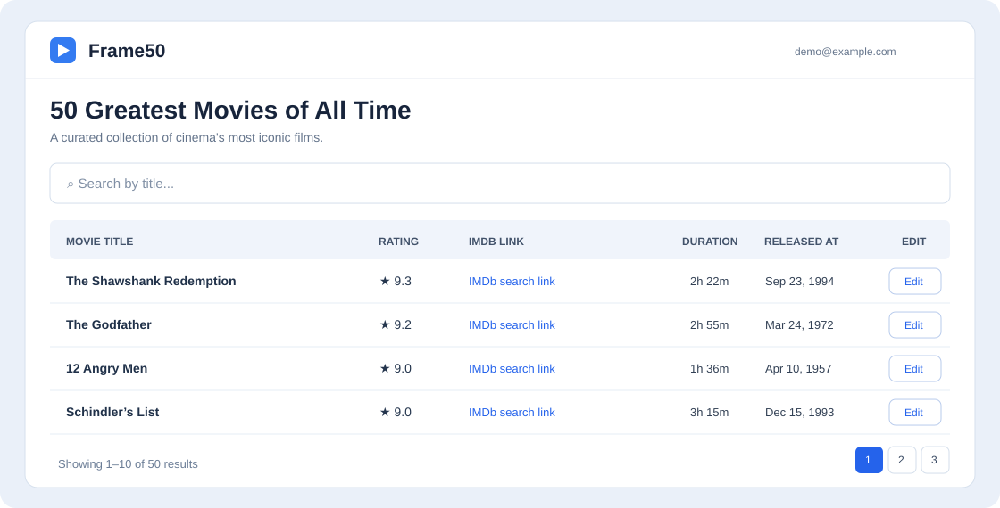
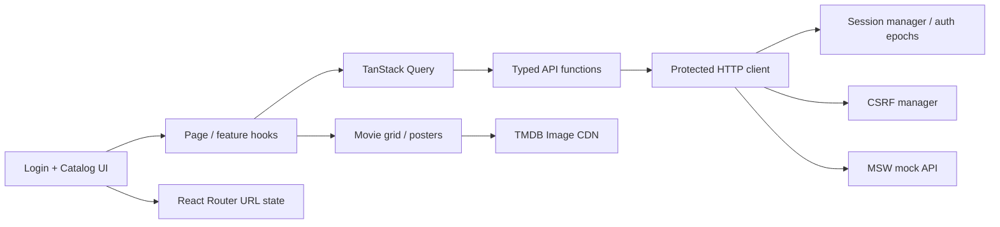

# Frame50

**A small movie catalog built around a difficult frontend problem: keeping authenticated, concurrent requests predictable.**

Frame50 lets you explore 50 curated films, switch between an editorial poster grid and a data table, search by title, browse nine results per page, and edit a movie's title or IMDb search link. The catalog is intentionally modest; the engineering focus is **authentication recovery, request concurrency, cache isolation, and resilient UI state**.



<sub>Illustrative UI preview, not a screenshot of the latest grid. The poster cards use static TMDB image paths; ratings are editorial fixture data, not live IMDb or TMDB scores. Replace this preview with a current screenshot when available.</sub>

## The engineering challenge

A protected data screen is easy in the happy path. The edge cases are harder: several requests expire together; a refresh returns after logout; a CSRF token goes stale during an edit; search and navigation change while data is loading. **How do we recover once, avoid accepting old responses, and keep the UI consistent?**

## Decisions worth reviewing

| Problem | Implemented decision | Why it matters |
| --- | --- | --- |
| Multiple requests receive `401` together | [Single-flight session rotation](src/shared/session/sessionManager.ts), [bounded recovery](src/shared/api/protectedClient.ts), and generation checks | Concurrent callers share one rotation rather than producing redundant refresh requests |
| An old request finishes after logout or re-login | [Auth epochs](src/shared/session/sessionManager.ts) guard protected responses and [mutations](src/features/webhooks/hooks/useUpdateWebhook.ts); [private queries](src/app/composition.ts) are cancelled/removed on invalidation | Old work cannot repopulate a new session's private cache |
| CSRF token expires during a write | [Shared CSRF token manager](src/shared/api/csrf.ts); recover from `419` with at most one CSRF retry per protected call | Failure recovery is explicit and bounded |
| Search and pagination diverge from browser history | [Canonical URL state](src/app/pages/webhooks/list/hooks/useWebhookListState.ts) and 350 ms debounced search | Stable back/forward behavior and shareable search results |
| Two views risk duplicating data logic | [Table/Grid switch](src/app/pages/webhooks/list/WebhooksPage.tsx) shares one paginated TanStack Query result and the same edit dialog | View changes do not refetch or reset page/search |
| Poster images hurt perceived loading | [Responsive TMDB URLs](src/features/webhooks/utils/posterUrl.ts) and [isolated poster lifecycle](src/app/pages/webhooks/list/components/MoviePoster.tsx) | Reserved aspect ratio, lazy images, blur placeholder, accessible fallback |

The main case study is **auth and request lifecycle correctness**. The catalog views and images are supporting examples of separation of concerns.

## System at a glance



**[Read the Solution Design](docs/solution-design.md)** for the authentication sequence, concurrent `401` and `419` flows, failure invariants, query-cache decisions, view composition, poster-loading behavior, and trade-offs.

## Project structure

```text
src/
├── app/
│   ├── composition.ts             # QueryClient, HTTP and session wiring
│   ├── router.tsx                  # Protected catalog and login routes
│   └── pages/
│       ├── login/                 # Login UI, form state and redirect
│       └── webhooks/
│           ├── list/             # Page composition, table/grid, poster, URL state
│           └── edit/             # Shared edit dialog, validation and save flow
├── features/
│   ├── auth/                       # Auth API, identity and session models
│   └── webhooks/                   # Catalog API, queries, mutation and poster URLs
├── shared/
│   ├── api/                        # HTTP transport, protected retries, CSRF
│   ├── session/                    # Single-flight rotation and auth epochs
│   └── hooks/, ui/, utils/         # Shared primitives
├── mocks/                          # MSW endpoints, session simulation and 50 films
└── test/                           # Integration test setup
```

The `webhooks` names and `/v1/webhooks` routes intentionally retain the original take-home API contract. UI branding is **Frame50**, not a claim that the backend contract was rewritten.

## Stack

React 19 · strict TypeScript · Vite · React Router · TanStack Query · Chakra UI v3 · MSW · Vitest · React Testing Library · oxlint.

## Run locally

Node.js `^22.12.0`, `^24.0.0`, or `>=26.0.0`.

```bash
npm install
npm run dev
```

Demo login:

```text
Email:    demo@example.com
Password: Frame50App-Demo-2026!
```

| Command | Purpose |
| --- | --- |
| `npm run dev` | Vite dev server; starts browser MSW before mounting React |
| `npm test` | Vitest unit and integration tests |
| `npm run typecheck` | Strict TypeScript checks |
| `npm run lint` | oxlint |
| `npm run build` | TypeScript + production bundle |

## Honest boundaries

- **Auth is simulated, not production security.** MSW models session issuance/rotation/revocation (30-second mock TTL), with a server-held-cookie *analogue*—not a real HttpOnly cookie. The device token is held in memory, and refreshing the page requires sign-in again.
- **Development mock API only.** `main.tsx` starts MSW only when `import.meta.env.DEV` is true. `npm run preview` does not provide an authenticated backend.
- **No live film integration.** Movie metadata and ratings are local fixtures; IMDb links open search results. TMDB poster paths are a static snapshot and images load directly from its CDN. This product is not endorsed by TMDB.
- **Ephemeral edits.** Updating title/URL changes mock memory; data is not persisted. Create/delete/status editing are outside scope.
- **Performance techniques, not benchmark claims.** Native image loading and responsive `srcSet` are implemented; no measured LCP/CLS or real-browser end-to-end performance results are claimed.

Originally a frontend technical assignment, adapted into a portfolio case study without replacing its core architectural decisions.
