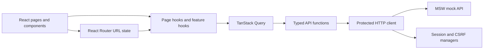

# Frame50

**50 iconic films. One small product. A closer look at production-minded frontend decisions.**

Frame50 is a curated movie catalog where users can sign in, explore 50 films sorted by rating, search by title, navigate paginated results, copy IMDb links, and edit a movie's title or link. The movie catalog is deliberately simple: the engineering case is about keeping **navigation, server state, forms, and authentication consistent** even when requests overlap or fail.


<sub>Illustrative preview of the current screen structure, not a live screenshot. Ratings and movie information are local demo fixtures, not a live IMDb feed.</sub>

## The engineering problem

A CRUD-style interface looks straightforward until a user searches, changes pages, edits a record, or loses their session while multiple requests are in flight. The design has to answer a few practical questions:

- How do we keep search, pagination, and browser history in sync?
- How do we avoid stale private data when a session ends or changes?
- How do we recover from expired sessions and CSRF tokens without retry loops?
- How do we keep pages focused on rendering rather than HTTP and state coordination?

## Decisions that matter

| Problem | Decision in this codebase | Outcome |
| --- | --- | --- |
| Search and page can drift from the URL | [Canonical URL state](src/app/pages/webhooks/list/hooks/useWebhookListState.ts) + 350 ms debounced search; page resets on new search | Shareable routes, consistent Back/Forward navigation |
| Multiple requests can receive `401` at once | [Shared rotation](src/shared/session/sessionManager.ts) and [bounded retries](src/shared/api/protectedClient.ts) with session-generation checks | No duplicate rotation storm; stale requests cannot silently revive an old session |
| Expired CSRF token can break an edit | [Shared CSRF refresh](src/shared/api/protectedClient.ts) after `419`, retried at most once per protected call | Predictable recovery without unbounded retries |
| Saved edits can leave old list data visible | [Detail-cache update + list invalidation](src/features/webhooks/hooks/useUpdateWebhook.ts); private cache cleared on logout | Consistent server-state lifecycle |
| UI and network rules are easy to entangle | [Page orchestration](src/app/pages/webhooks/list/hooks/useWebhooksPage.ts), colocated feature UI, shared HTTP/session infrastructure | Components stay focused, with independently testable behavior |

## At a glance



The diagram shows actual module responsibilities. **MSW is a browser-side mock API, not a separate production server.**

**[Read the Solution Design →](docs/solution-design.md)** — detailed flows, sequence diagrams, module boundaries, trade-offs, and test coverage.

## Project structure

```text
src/
├── app/
│   ├── composition.ts             # QueryClient, HTTP client and session wiring
│   ├── router.tsx                  # Login and protected catalog route
│   ├── components/                # Application shell and header
│   └── pages/
│       ├── login/                 # Login UI, form hook and validation
│       └── webhooks/              # Catalog page, search, table and edit dialog
├── features/
│   ├── auth/                       # Auth API, hooks and session-related model
│   └── webhooks/                   # Catalog API, query hooks, types and keys
├── shared/
│   ├── api/                        # HTTP, protected request and CSRF logic
│   ├── session/                    # Session concurrency manager
│   ├── hooks/                      # Reusable hooks
│   ├── ui/                         # Shared dialog
│   └── utils/                      # Clipboard helper
├── mocks/                          # Local MSW handlers and movie fixtures
└── test/                           # Test setup
```

The internal `webhooks` names and `/v1/webhooks` endpoints are retained from the original API contract. Frame50 is the portfolio-facing product identity; this documentation describes the existing implementation rather than disguising it as a new backend.

## Stack

React 19 · TypeScript (strict) · Vite · React Router · TanStack Query · Chakra UI v3 · MSW · Vitest · React Testing Library · oxlint.

## Run locally

Node.js `^22.12.0`, `^24.0.0`, or `>=26.0.0`.

```bash
npm install
npm run dev
```

Use the credentials displayed on the login screen:

```text
Email:    demo@example.com
Password: Frame50App-Demo-2026!
```

| Command | Purpose |
| --- | --- |
| `npm run dev` | Vite development server with the MSW worker |
| `npm test` | Unit and integration tests |
| `npm run typecheck` | Strict TypeScript check |
| `npm run lint` | oxlint |
| `npm run build` | TypeScript project build + Vite production build |

## Scope and limitations

- **Local API only:** Vite starts the browser MSW worker only in development (`import.meta.env.DEV`). A standalone production build or `npm run preview` does **not** provide an API by itself.
- The 50 films, ratings, durations, and release dates are static editorial demo data. IMDb URLs are search links; there is no IMDb integration.
- Edits update the in-memory mock data; they do not survive a full reset/reload. Create, delete, and status editing are not implemented.
- Auth uses a simulated session (30-second TTL), a development captcha token, and an HttpOnly-cookie **analogue** in MSW. This is a frontend exercise, not a production security implementation.
- The layout is primarily desktop-focused. The test suite covers unit and integration scenarios, not browser E2E tests.

Originally built as a technical assignment and later adapted into a portfolio case study. The documentation intentionally highlights design choices and their limits without refactoring the original solution.