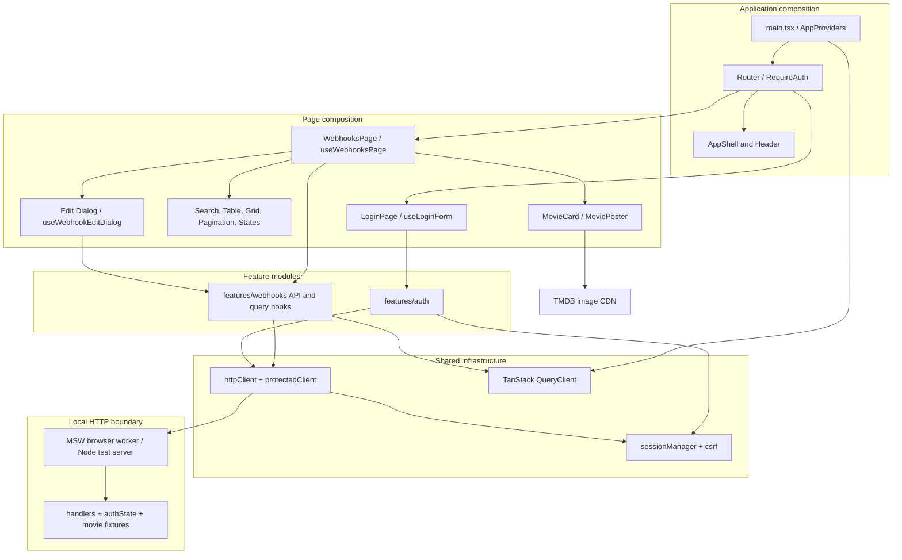
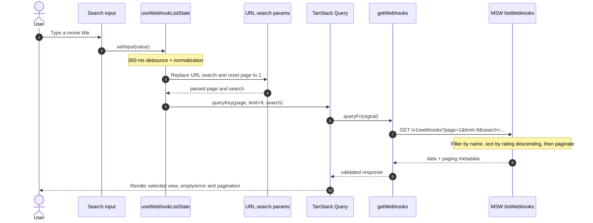
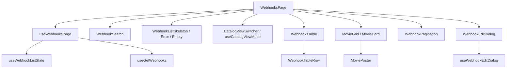
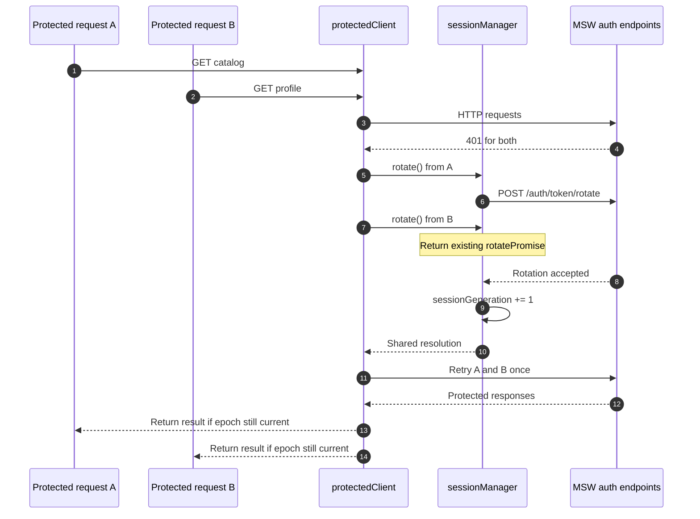
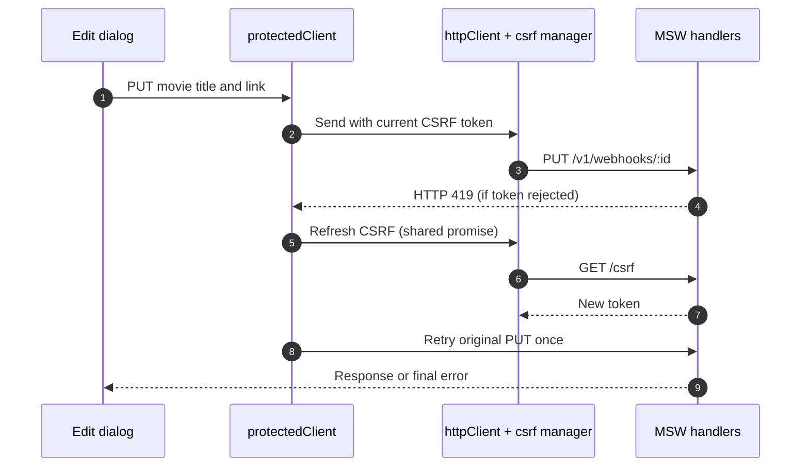
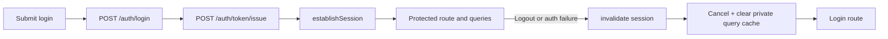
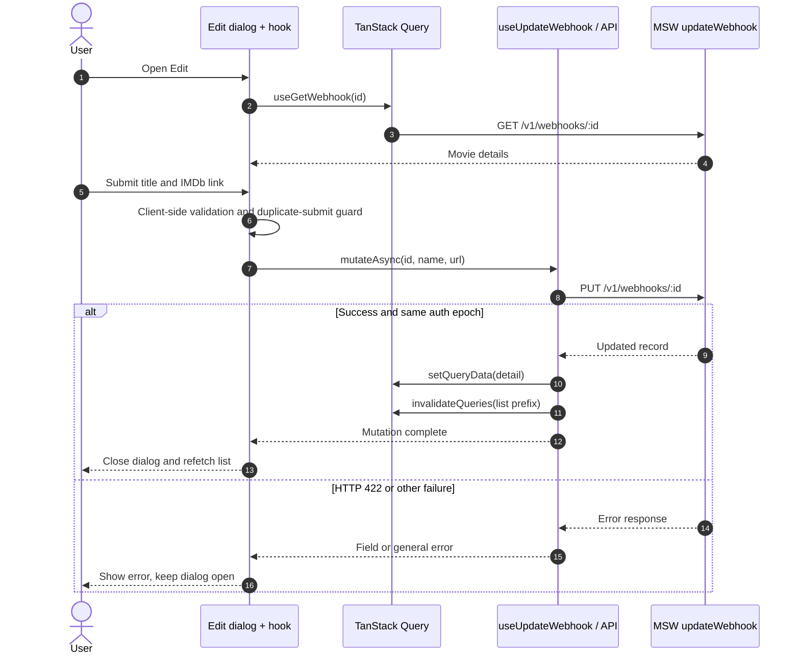
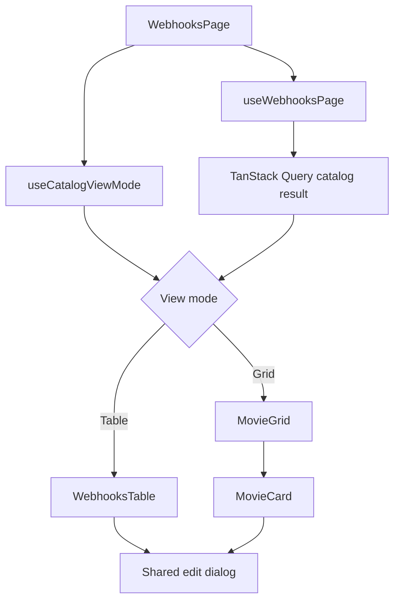
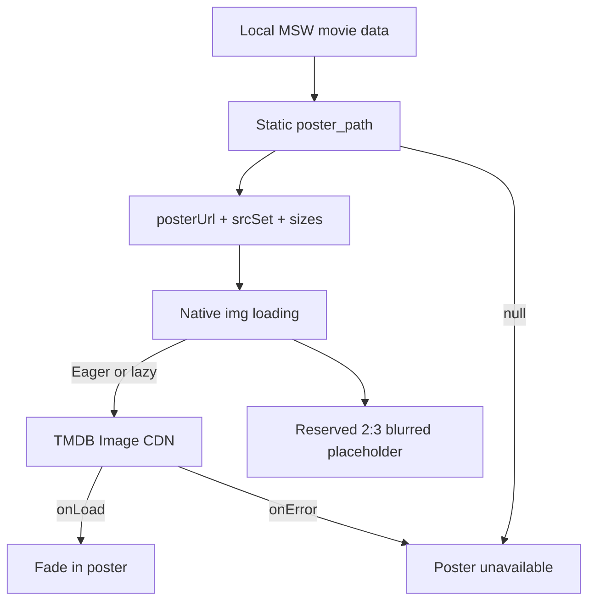

# Frame50 — Solution Design

> **Scope:** architecture walkthrough of the current `main` codebase, reviewed November 5, 2026. This documents existing behavior; it is not a refactoring proposal. The main design case is **authentication and asynchronous request correctness**.
>
> [← Back to README](../README.md)

## 1. Context and constraints

Frame50 is a small React movie catalog with sign-in, a table/grid toggle, search, nine-item URL-driven pagination, detail editing, rating-sorted results and CDN-hosted movie posters. **Its main technical challenge is authentication correctness under concurrency:** multiple expired requests, in-flight refreshes, logout/re-login races and stale private-cache writes. The other design decisions—URL state, shared data fetching and image loading—show how that cross-cutting infrastructure supports a simple product.

**Constraints in this implementation:** a React SPA; mock API via browser MSW during development and MSW Node handlers in tests; static TMDB poster paths with direct browser requests to TMDB's image CDN; no separate API server, database, or persistent catalog; the original `/v1/webhooks` contract and internal names are retained. React 19, strict TypeScript, Vite, React Router, TanStack Query and Chakra UI v3 comprise the application stack.

**Non-goals:** production authentication, runtime movie-metadata APIs, scraping IMDb, durable edits, creating/deleting records, status editing and broad architectural rewrites. The **TMDB Image CDN is an external image resource**, not a catalog backend or runtime movie API.

## 2. Architecture and boundaries

`src/app/composition.ts` creates the shared `http`, `protectedClient`, `session`, and `queryClient` instances and publishes authentication change notifications. `src/app/router.tsx` composes a protected index route and the login route. Feature hooks use TanStack Query and API functions; the pages compose rendering components and interaction orchestration.

The module structure is **feature-oriented with colocation**, not strict Feature-Sliced Design or pure Clean Architecture: for example, a mutation hook imports `queryClient` and `session` from `app/composition.ts`. This is a pragmatic coupling in a small application, not an invisible dependency.

### 2.1 Actual directory ownership

| Location | Responsibility | Examples |
| --- | --- | --- |
| `src/app/` | Runtime wiring, providers, routes, page composition | `composition.ts`, `router.tsx` |
| `src/app/pages/login/` | Login UI and form-local behavior | `LoginPage.tsx`, `useLoginForm.ts` |
| `src/app/pages/webhooks/list/` | Catalog presentation and route-aware UI orchestration, view switch, poster states | `WebhooksPage.tsx`, `MovieGrid.tsx`, `MoviePoster.tsx`, `useCatalogViewMode.ts` |
| `src/app/pages/webhooks/edit/` | Edit dialog and form validation | `useWebhookEditDialog.ts`, `webhookForm.ts` |
| `src/features/auth/` | Authentication API and user/session models | `authApi.ts`, `currentUser.ts` |
| `src/features/webhooks/` | Catalog API contracts, query keys, data hooks and poster URLs | `webhooksApi.ts`, `useUpdateWebhook.ts`, `posterUrl.ts` |
| `src/shared/api/` | HTTP concerns independent of catalog UI | `httpClient.ts`, `protectedClient.ts`, `csrf.ts` |
| `src/shared/session/` | Session state and rotation coordination | `sessionManager.ts` |
| `src/mocks/` | In-memory API simulator and deterministic fixtures | `handlers.ts`, `webhooks.ts`, `authState.ts` |

**Why colocate?** Catalog-specific hooks, table, grid, poster and edit components live near the catalog page; shared infrastructure is reserved for genuinely cross-cutting concerns. This shortens navigation paths during maintenance while keeping feature APIs independently understandable.

**Trade-off:** a few names still refer to `webhooks`, including types, paths, and files. They accurately describe the preserved technical contract but do not mirror the new product name. Avoid renaming without a functional reason.

## 3. Decision record

| ID | Problem / risk | Current decision | Trade-off |
| --- | --- | --- | --- |
| D1 | Navigation and search can disagree | URL is canonical for page and committed search; separate debounced input | More synchronization logic in one hook |
| **D2** | **Concurrent `401` responses can duplicate refreshes** | **Shared rotation promise, generation and epoch guards** | Additional session bookkeeping |
| **D3** | **CSRF token expiration during mutation** | **Shared refresh after `419`, bounded retry budgets** | Depends on backend error convention |
| D4 | Data shown after an edit can be stale | Detail cache update and list-prefix invalidation | List refetch instead of optimistic list patching |
| **D5** | **Private queries may outlive a session** | **Private query prefix, cancellation/removal and auth-epoch checks** | Requires a consistent private-query convention |
| D6 | Demo must work without a remote API | MSW intercepts HTTP calls in development and tests | Does not verify real server security/integration |
| D7 | UI components can accumulate business logic | Page composition + feature hooks and colocated components | Small explicit wiring layer and more files |
| D8 | Different catalog views could fork business logic | Shared TanStack Query state, page state, edit dialog, presentation-only table/grid | View-specific rendering remains separate |
| D9 | Movie posters can cause unnecessary network work and layout shifts | Static TMDB paths, responsive srcSet/sizes, eager/lazy priorities, 2:3 reserved area, blur/error fallback | CDN dependency, static mappings and no measured performance benchmark |

### Authentication correctness: the central case study

The critical behavior is **not the login form itself**. It is what happens when asynchronous requests overlap an expiring session or a logout. This is implemented across four explicit boundaries:

1. **HTTP protocol:** `httpClient` enforces same-origin paths, required headers and typed errors.
2. **Recovery coordination:** `protectedClient` bounds `401` and `419` retries; `sessionManager` ensures only one rotation promise is active for the current session.
3. **Session identity:** `authEpoch` invalidates work started under a previous session, while `sessionGeneration` distinguishes completed rotations within the same session.
4. **Private server state:** `composition.ts` cancels and removes queries under `['private']`; mutations check the epoch before writing to the cache.

**Invariant:** a successful network response is only usable while the session that started it is still current. See [HTTP and recovery](#5-http-csrf-and-session-recovery), [authentication lifecycle](#6-authentication-lifecycle) and [cache consistency](#7-edit-workflow-and-cache-consistency).

## 4. URL state and catalog flow

The page reads `page` and `search` using `useSearchParams` via `useWebhookListState`. **Both table and grid use the same page of nine records**. It canonicalizes invalid/duplicate page values, trims search text, omits page one/empty search from the URL, and uses `replace` for normalization. Search input is debounced by **350 ms**, and committing new search text resets page to one. Browser Back/Forward restores route-derived state. Out-of-range pages are replaced with the last available page after the API returns pagination metadata.

Query keys include `page`, `limit`, and `search` under `['private', 'webhooks']`; therefore distinct URLs map to distinct cache entries. Search and pagination happen in the MSW handler, **not** as a client-side filter after fetching one page. The mock currently holds exactly 50 curated movies, sorts matches by descending static rating and paginates the results with a **client-requested limit of nine**.

**Important nuance:** The route and the network request each have a separate concern. The URL provides navigation state; TanStack Query owns remote-like results, loading and refetch state; MSW supplies the current dataset. Keeping these apart makes the behavior observable and testable.

### Page composition

`useWebhooksPage` decides which result state to show; `WebhooksPage` chooses the presentation using `useCatalogViewMode`. The table and grid receive the **same** `records.data` and `openEdit` callback. Only the view preference goes to `localStorage` (`frame50.catalogView`); search/page remain in the URL and are not reset when switching. Grid is the default when no valid stored choice exists. Individual rows handle display and copy-URL feedback; the dialog owns form-specific state through a separate hook.

## 5. HTTP, CSRF, and session recovery

### 5.1 Base HTTP client

`src/shared/api/httpClient.ts` allows **root-relative, same-origin** paths, attaches `X-Requested-With: XMLHttpRequest`, JSON-encodes request bodies, loads the CSRF token through `GET /csrf`, and attaches `X-CSRF-TOKEN` to `POST` and `PUT` requests. It parses successful JSON and converts unsuccessful HTTP responses into typed `HttpError` objects (status, error type and optional field errors).

`src/shared/api/csrf.ts` memoizes an in-flight CSRF load and tracks an epoch, so obsolete token fetches cannot overwrite newer state. The `protectedClient` adds **bounded recovery**: up to one `419` recovery and one `401` recovery for each request call. Parallel CSRF refreshes are deduplicated through a shared promise; if another request already replaced the token, a request can retry using the newer token without triggering a redundant refresh.

### 5.2 Concurrent session rotation

`src/shared/session/sessionManager.ts` stores `active`, `authEpoch`, `sessionGeneration`, and a single `rotatePromise`. Each protected request captures the current epoch and generation. If the server responds with `401`, the first eligible request initiates `/auth/token/rotate`; concurrent requests share the same promise. A call that observes that another request already advanced the generation skips its own rotate and retries. Failure (or a second `401`) invalidates only the matching active session.

**Failure path:** if rotation fails, or a retried request still gets `401`, the current session is invalidated. `app/composition.ts` cancels and removes all queries under `['private']`, clears the in-memory device session token and notifies subscribers. `useAuthActive` uses `useSyncExternalStore`; the protected route sends the user to login.

**Race-safety invariant:** a response from an earlier login/session must not populate the current UI after logout or re-login. Protected requests compare captured `authEpoch` against the active one before returning data. The mutation hook separately checks the auth epoch before updating the cache. Rotation uses generation checks to coordinate concurrent 401s within one epoch.

**Abort nuance:** requests honor `AbortSignal`; an aborted waiter does not necessarily cancel the shared rotation needed by other callers. This avoids allowing one cancelled consumer to interrupt recovery for others.

**Retry budgets:** each protected call permits at most one authentication recovery and one CSRF recovery. They are separate budgets, not a promise of eventual success. A failed rotation or a second `401` invalidates the current epoch; the request does not enter an infinite retry loop.

### 5.3 CSRF expiration recovery

This documents the client recovery path; the currently bundled MSW handlers normally return a fixed mock CSRF token rather than simulating token expiry by default. The recovery path is exercised with HTTP-level tests.

## 6. Authentication lifecycle

`features/auth/api/authApi.ts` posts an email, password, 32-character local fingerprint, and development captcha token to `/auth/login`. It then sends the returned `device_session_token` to `/auth/token/issue`. Once issue succeeds, `establishSession()` marks the local session active; protected pages load `/v1/me` and catalog data. Logout invalidates the local session and sends `/auth/token/revoke` while serialization prevents late revoke/login races.

**Login/logout race control:** `authApi.ts` increments a login-attempt counter to reject obsolete completions and serializes revocations using `revokeChain`. A new login waits for pending revocations, preventing a late revoke from racing with a newly issued session. This is distinct from the single-flight `401` recovery used by protected queries.

The returned token is stored **in JS module memory** (`deviceSession.ts`), not localStorage. The fingerprint alone is persisted to localStorage. The mock stores the issued session internally as an analogue of a server-managed HttpOnly cookie. A page refresh loses the frontend session and requires sign-in again. `RequireAuth` preserves the original pathname/search in route state so a successful sign-in can return to the intended catalog URL.

**Security boundary:** this does **not** implement a real HttpOnly cookie, server-based fingerprint assurance, captcha verification, or production authentication. MSW session TTL is **30 seconds** to make recovery scenarios testable. The security-related code illustrates frontend state and protocol behavior, not a production security guarantee.

## 7. Edit workflow and cache consistency

The edit modal receives an ID, loads detail using `useGetWebhook`, initializes local form fields when a new detail record arrives, and validates title and URL before issuing a `PUT`. A ref guard prevents repeated submissions while saving. HTTP `422` field errors can appear beside the affected inputs; other failures appear as general errors. The modal remains open on failure.

The list is **invalidated**, not optimistically rewritten. This is a reasonable choice for a small paginated, server-sorted dataset because edits can alter which rows match a search. The cost is an extra list request; a real large catalog might warrant more explicit cache policies or optimistic behavior after measuring actual user experience.

The request/response model still uses the internal `Webhook` type (`id`, `name`, `url`, `rating`, `duration`, `poster_path`, `active`, `created_at`). UI presents `name` as a movie title, `url` as an IMDb search link, `rating` and `duration` as display metadata, and `created_at` as a release date. Only `name` and `url` can be edited.

## 8. Local MSW boundary and data assumptions

`src/app/main.tsx` starts `setupWorker(...handlers)` before mounting React, **only when `import.meta.env.DEV` is true**. Tests instead use the MSW Node server (`src/mocks/server.ts`). This lets the real HTTP client exercise same-origin requests and error responses without deploying a backend.

The local API supports:

| Endpoint | Current behavior |
| --- | --- |
| `GET /csrf` | Mock CSRF token header |
| `POST /auth/login` | Validate demo credentials and fingerprint |
| `POST /auth/token/issue` | Start mock session |
| `POST /auth/token/rotate` | Refresh mock session |
| `POST /auth/token/revoke` | End mock session |
| `GET /v1/me` | Current user in active mock session |
| `GET /v1/webhooks` | Search, descending rating sort, pagination |
| `GET /v1/webhooks/:id` | Movie details |
| `PUT /v1/webhooks/:id` | Validate/edit title and URL |

Movie records are deterministic local fixtures; there is no live IMDb data, no database, and no persistence after reset/reload. Every record is assigned an IMDb **search URL** rather than a confirmed individual IMDb title page. The `active` property is retained in the API contract but is not shown as a status column in the current table.

**Production caveat:** `npm run build` creates a static bundle but does not start the mock API in the production output. `npm run preview` alone cannot exercise catalog authentication/data unless a compatible backend or explicitly configured production mock layer exists. This is a deliberate boundary of the documented version, not a deployed full-stack product.

## 9. Validation and failure handling

- **HTTP boundaries:** response parsing rejects structurally invalid payloads (`webhooksApi.ts`, `currentUser.ts`); HTTP errors become `HttpError` with status/type/field payloads.
- **Form boundaries:** login and edit validation run before submission; backend `422` maps to per-field errors; unexpected failures are visible to the user.
- **Loading/error states:** skeletons, empty search result, refetch spinner, detail loading and retry actions are composed in the page and dialog.
- **Navigation boundaries:** malformed page params fall back to page one; out-of-range pages normalize to the last page.
- **Session boundaries:** aborts are not treated as authentication failures; stale epochs reject out-of-date work.

## 10. Testing strategy

This repository uses Vitest + React Testing Library with an MSW Node test server. Tests are organized near the behavior they protect:

| Area | Tests | Relevant source |
| --- | --- | --- |
| HTTP and CSRF | Token loading, header behavior, error parsing, retries | `src/shared/api/*.test.ts` |
| Protected requests / session | Concurrent `401`, rotation failure, aborts, stale epochs and retries | `src/shared/api/protectedClient.test.ts`, `src/shared/session/sessionManager.test.ts` |
| Router, login and catalog | Guard, login, search, URL normalization, pagination, edit flows | `src/features/auth/__tests__`, `src/app/pages/webhooks/__tests__` |
| Pure utility behavior | Search-param rules, debounce, fingerprint, clipboard and poster URLs | `src/app/pages/webhooks/list/utils`, `src/shared/hooks`, `src/shared/utils`, `src/features/webhooks/utils/posterUrl.test.ts` |
| View composition | Grid default and persisted mode, switching without refetch, nine results, edit actions | `src/app/pages/webhooks/__tests__/catalogView.test.tsx` |
| Poster lifecycle | Load/blur/error state, per-path reset and responsive source attributes | `src/app/pages/webhooks/list/components/MoviePoster.test.tsx` |

The tests cover unit and integrated frontend flows. They do not establish browser-level E2E coverage, real backend compatibility, security audit results or performance benchmarks. In particular, an image element's DOM attributes and dispatched load/error events do not measure actual CDN network behavior.

## 11. Table/Grid presentation: one source of truth (D8)

**Problem.** Two presentations of the same catalog can easily grow separate searches, pagination state, fetches or edit flows. That makes the UI inconsistent and creates network work solely because a user changes layout.

**Implemented decision.** `WebhooksPage` calls `useWebhooksPage` once and passes its paginated `records.data` to either `WebhooksTable` or `MovieGrid`. The same `openEdit` handler opens `WebhookEditDialog`. `useCatalogViewMode` stores the chosen view in `localStorage` under `frame50.catalogView`; **Grid is the default** when the value is absent or invalid. The view selection does not change the query key or URL. Search/pagination remain driven by `useWebhookListState` and are independent of the display choice.

**Trade-off.** Two presentation components are maintained, but one data lifecycle remains authoritative. Table-specific tests explicitly set table mode because the product's default is now grid.

## 12. Optimized poster delivery and lifecycle (D9)

**Problem.** A gallery can waste bandwidth by requesting oversized offscreen images, shift its layout while images load, and leave blank or broken cards when a CDN request fails.

**Implemented decision.** The MSW movie fixtures supply a static `poster_path` per record. The catalog does **not** call the TMDB API at runtime: the browser builds URLs under `https://image.tmdb.org/t/p/` and requests posters from the **TMDB Image CDN**, separately from the mocked catalog API. `posterUrl.ts` constructs `w185`, `w342` and `w500` variants with `srcSet`, with `src` at `w342` and `sizes` matching a 104px base / 112px `md` poster column. Actual source selection is browser-controlled, including device-pixel ratio.

`MovieGrid` renders only the current nine records. The first poster is eager with `fetchPriority="high"`; the next two are eager; the remaining posters are lazy. Each `MoviePoster` reserves a **2:3** region, uses `decoding="async"`, displays a blurred CSS gradient until the image fires `onLoad`, and fades the image in. On `onError` or a null path, the same region displays **Poster unavailable**. The transition is disabled by `prefers-reduced-motion`.

The inner `PosterImage` is keyed by `posterPath`, making load/error state specific to the current path. Switching A → B → A remounts the image state, so an earlier failure does not permanently block a retry. No extra low-resolution placeholder image is downloaded, and no custom preloading or `IntersectionObserver` has been added.

**Trade-offs and limits.** The stable CDN URLs can benefit from normal browser caching, but images still depend on TMDB availability and correct static mappings. A `w185` or `w342` request is not proof of a measured byte saving or improved LCP; those require real-device and network profiling. Film ratings remain editorial and are not sourced from TMDB. The UI includes TMDB attribution and a non-endorsement notice, with no claim that TMDB sponsors Frame50.

## 13. Intentional limitations and possible extensions

- **No standalone production API:** add a real backend or an explicitly production-supported demo mocking strategy before advertising a public live demo.
- **Ephemeral data:** a database or persistence adapter would be necessary for durable edits; the current scope does not require one.
- **Responsive UI, not a browser-audited product:** the grid uses one/two/three columns at base/md/lg breakpoints. Real-device accessibility and visual regression testing are still appropriate.
- **Existing internal naming:** webhook-specific symbols remain; changing them would be an orthogonal, nonessential refactor.
- **Static editorial dataset and posters:** 50 movies use static ratings, release metadata and TMDB poster paths. No runtime TMDB metadata fetch or IMDb scraping occurs. Large-scale behavior, real latency, measured image performance and observability are not demonstrated.
- **Security simulation only:** a production auth flow would need proper cookie/session handling, CSRF/captcha enforcement, session fixation defense and server-side review.

The engineering lesson is deliberately modest: **predictable state transitions, explicit boundaries, and bounded recovery mechanisms make even a small UI maintainable under asynchronous failure.**

---

[← Back to README](../README.md)