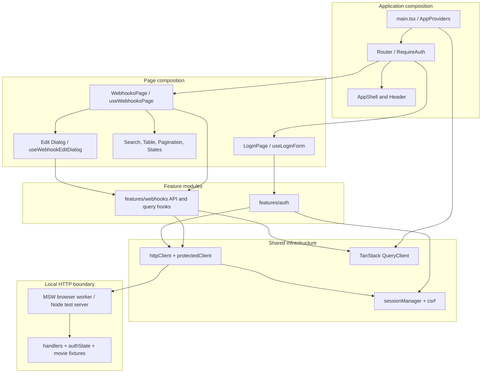
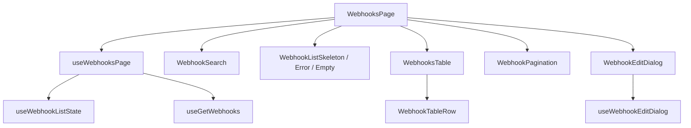
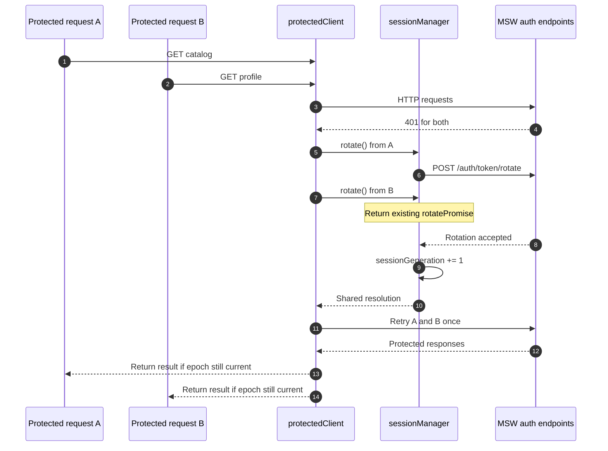
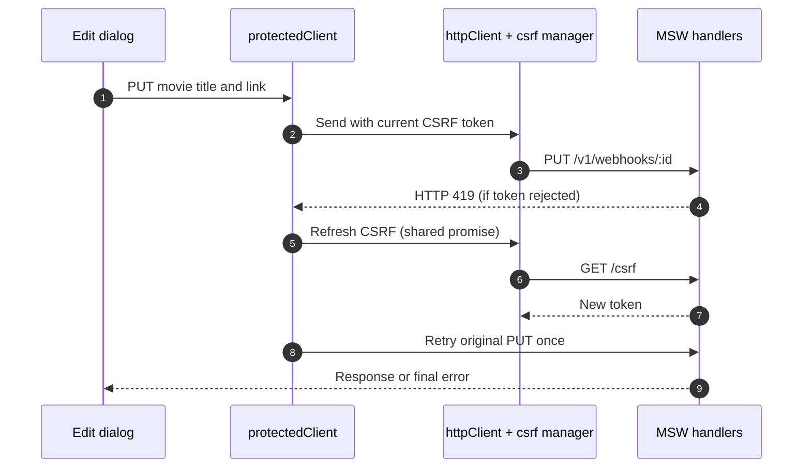
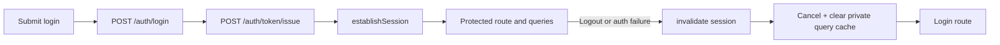
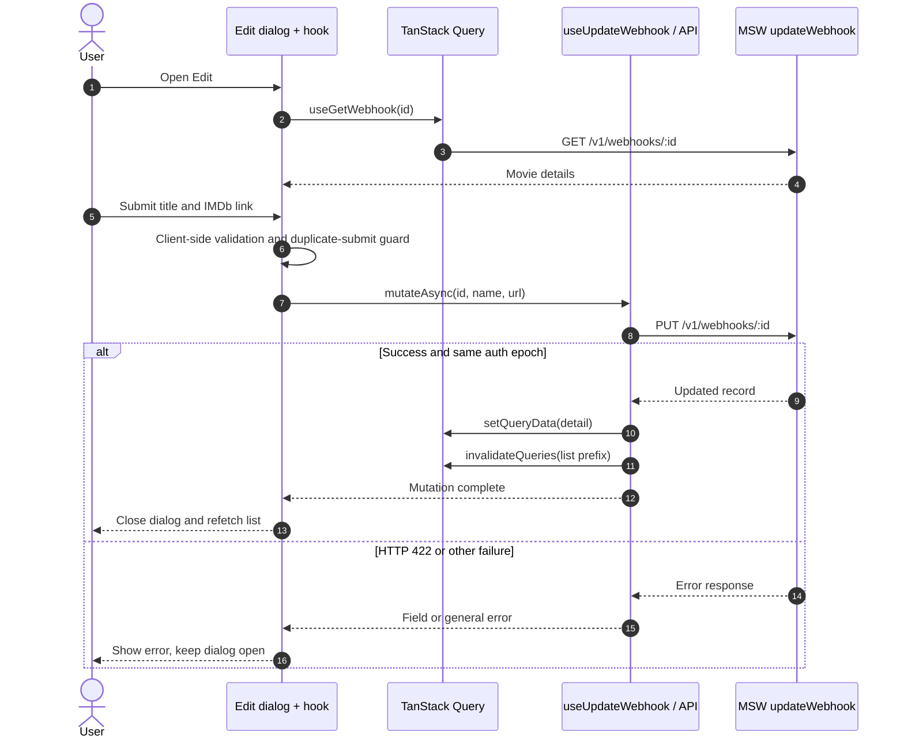

# Frame50 — Solution Design

> **Scope:** documentation of the existing `main` implementation (commit `5fcff1d195b817ef49bcfdb0a6610573c1766064`, reviewed November 5, 2026). This is an architecture walkthrough, **not** a proposal to refactor the codebase.
>
> [← Back to README](../README.md)

## 1. Context and constraints

Frame50 is a small React movie catalog with sign-in, title search, URL-based pagination, detail editing, rating-sorted results, and locally mocked HTTP endpoints. Its primary technical challenge is not the movie data: it is coordinating asynchronous requests, route state, authentication, and private server state with predictable outcomes.

**Constraints in this implementation:** a React SPA; mock API via browser MSW during development and MSW Node handlers in tests; no separate API server, database, or persistent catalog; the original `/v1/webhooks` contract and internal names are retained. React 19, strict TypeScript, Vite, React Router, TanStack Query, and Chakra UI v3 comprise the application stack.

**Non-goals:** production authentication, real IMDb integrations, external APIs, creating/deleting records, status editing, and broad architectural rewrites.

## 2. Architecture and boundaries

`src/app/composition.ts` creates the shared `http`, `protectedClient`, `session`, and `queryClient` instances and publishes authentication change notifications. `src/app/router.tsx` composes a protected index route and the login route. Feature hooks use TanStack Query and API functions; the pages compose rendering components and interaction orchestration.

The module structure is **feature-oriented with colocation**, not strict Feature-Sliced Design or pure Clean Architecture: for example, a mutation hook imports `queryClient` and `session` from `app/composition.ts`. This is a pragmatic coupling in a small application, not an invisible dependency.

### 2.1 Actual directory ownership

| Location | Responsibility | Examples |
| --- | --- | --- |
| `src/app/` | Runtime wiring, providers, routes, page composition | `composition.ts`, `router.tsx` |
| `src/app/pages/login/` | Login UI and form-local behavior | `LoginPage.tsx`, `useLoginForm.ts` |
| `src/app/pages/webhooks/list/` | Catalog presentation and route-aware UI orchestration | `WebhooksPage.tsx`, `useWebhookListState.ts` |
| `src/app/pages/webhooks/edit/` | Edit dialog and form validation | `useWebhookEditDialog.ts`, `webhookForm.ts` |
| `src/features/auth/` | Authentication API and user/session models | `authApi.ts`, `currentUser.ts` |
| `src/features/webhooks/` | Catalog API contracts, query keys and data hooks | `webhooksApi.ts`, `useUpdateWebhook.ts` |
| `src/shared/api/` | HTTP concerns independent of catalog UI | `httpClient.ts`, `protectedClient.ts`, `csrf.ts` |
| `src/shared/session/` | Session state and rotation coordination | `sessionManager.ts` |
| `src/mocks/` | In-memory API simulator and deterministic fixtures | `handlers.ts`, `webhooks.ts`, `authState.ts` |

**Why colocate?** A catalog-specific state machine and its table components live near the catalog page; shared infrastructure is reserved for genuinely cross-cutting concerns. This shortens navigation paths during maintenance while keeping feature APIs independently understandable.

**Trade-off:** a few names still refer to `webhooks`, including types, paths, and files. They accurately describe the preserved technical contract but do not mirror the new product name. Avoid renaming without a functional reason.

## 3. Decision record

| ID | Problem / risk | Current decision | Trade-off |
| --- | --- | --- | --- |
| D1 | Navigation and search can disagree | URL is canonical for page and committed search; separate debounced input | More synchronization logic in one hook |
| D2 | Concurrent `401` responses can duplicate refreshes | Shared rotation promise and generation / epoch guards | Extra session bookkeeping |
| D3 | CSRF token expiration during mutation | Shared refresh after `419`, at most one CSRF retry per protected call | Client depends on backend error convention |
| D4 | Data shown after an edit can be stale | Detail cache update and list-prefix invalidation | List refetch instead of optimistic list patching |
| D5 | Private queries may outlive the session | All private keys share prefix, removed on session invalidation | Session-specific query convention must be maintained |
| D6 | Demo must be testable without remote services | MSW intercepts the same HTTP interface as production-oriented code | Does not validate real server security/integration |
| D7 | UI components can accumulate business logic | Presentation composed from page hooks and feature hooks | Additional files; small explicit wiring layer |

## 4. URL state and catalog flow

The page reads `page` and `search` using `useSearchParams` via `useWebhookListState`. It canonicalizes invalid/duplicate page values, trims search text, omits page one/empty search from the URL, and uses `replace` for normalization. Search input is debounced by **350 ms**, and committing new search text resets page to one. Browser Back/Forward restores route-derived state. Out-of-range pages are replaced with the last available page after the API returns pagination metadata.

Query keys include `page`, `limit`, and `search` under `['private', 'webhooks']`; therefore distinct URLs map to distinct cache entries. Search and pagination happen in the MSW handler, **not** as a client-side filter after fetching one page. The mock currently holds exactly 50 curated movies and sorts matches by descending static rating.

**Important nuance:** The route and the network request each have a separate concern. The URL provides navigation state; TanStack Query owns remote-like results, loading and refetch state; MSW supplies the current dataset. Keeping these apart makes the behavior observable and testable.

### Page composition

`useWebhooksPage` decides which result state to show; `WebhooksPage` composes components; individual rows handle display and copy-URL feedback. The dialog owns form-specific state through a separate hook.

## 5. HTTP, CSRF, and session recovery

### 5.1 Base HTTP client

`src/shared/api/httpClient.ts` allows **root-relative, same-origin** paths, attaches `X-Requested-With: XMLHttpRequest`, JSON-encodes request bodies, loads the CSRF token through `GET /csrf`, and attaches `X-CSRF-TOKEN` to `POST` and `PUT` requests. It parses successful JSON and converts unsuccessful HTTP responses into typed `HttpError` objects (status, error type and optional field errors).

`src/shared/api/csrf.ts` memoizes an in-flight CSRF load and tracks an epoch, so obsolete token fetches cannot overwrite newer state. The `protectedClient` adds **bounded recovery**: up to one `419` recovery and one `401` recovery for each request call. Parallel CSRF refreshes are deduplicated through a shared promise; if another request already replaced the token, a request can retry using the newer token without triggering a redundant refresh.

### 5.2 Concurrent session rotation

`src/shared/session/sessionManager.ts` stores `active`, `authEpoch`, `sessionGeneration`, and a single `rotatePromise`. Each protected request captures the current epoch and generation. If the server responds with `401`, the first eligible request initiates `/auth/token/rotate`; concurrent requests share the same promise. A call that observes that another request already advanced the generation skips its own rotate and retries. Failure (or a second `401`) invalidates only the matching active session.

**Failure path:** if rotation fails, or a retried request still gets `401`, the current session is invalidated. `app/composition.ts` cancels and removes all queries under `['private']`, clears the in-memory device session token and notifies subscribers. `useAuthActive` uses `useSyncExternalStore`; the protected route sends the user to login.

**Race-safety invariant:** a response from an earlier login/session must not populate the current UI after logout or re-login. Protected requests compare captured `authEpoch` against the active one before returning data. The mutation hook separately checks the auth epoch before updating the cache. Rotation uses generation checks to coordinate concurrent 401s within one epoch.

**Abort nuance:** requests honor `AbortSignal`; an aborted waiter does not necessarily cancel the shared rotation needed by other callers.

### 5.3 CSRF expiration recovery

This documents the client recovery path; the currently bundled MSW handlers normally return a fixed mock CSRF token rather than simulating token expiry by default. The recovery path is exercised with HTTP-level tests.

## 6. Authentication lifecycle

`features/auth/api/authApi.ts` posts an email, password, 32-character local fingerprint, and development captcha token to `/auth/login`. It then sends the returned `device_session_token` to `/auth/token/issue`. Once issue succeeds, `establishSession()` marks the local session active; protected pages load `/v1/me` and catalog data. Logout invalidates the local session and sends `/auth/token/revoke` while serialization prevents late revoke/login races.

The returned token is stored **in JS module memory** (`deviceSession.ts`), not localStorage. The fingerprint alone is persisted to localStorage. The mock stores the issued session internally as an analogue of a server-managed HttpOnly cookie. A page refresh loses the frontend session and requires sign-in again. `RequireAuth` preserves the original pathname/search in route state so a successful sign-in can return to the intended catalog URL.

**Security boundary:** this does **not** implement a real HttpOnly cookie, server-based fingerprint assurance, captcha verification, or production authentication. MSW session TTL is **30 seconds** to make recovery scenarios testable. The security-related code illustrates frontend state and protocol behavior, not a production security guarantee.

## 7. Edit workflow and cache consistency

The edit modal receives an ID, loads detail using `useGetWebhook`, initializes local form fields when a new detail record arrives, and validates title and URL before issuing a `PUT`. A ref guard prevents repeated submissions while saving. HTTP `422` field errors can appear beside the affected inputs; other failures appear as general errors. The modal remains open on failure.

The list is **invalidated**, not optimistically rewritten. This is a reasonable choice for a small paginated, server-sorted dataset because edits can alter which rows match a search. The cost is an extra list request; a real large catalog might warrant more explicit cache policies or optimistic behavior after measuring actual user experience.

The request/response model still uses the internal `Webhook` type (`id`, `name`, `url`, `rating`, `duration`, `active`, `created_at`). UI presents `name` as a movie title, `url` as an IMDb search link, `rating` and `duration` as display metadata, and `created_at` as a release date. Only `name` and `url` can be edited.

## 8. Local MSW boundary and data assumptions

`src/app/main.tsx` starts `setupWorker(...handlers)` before mounting React, **only when `import.meta.env.DEV` is true**. Tests instead use the MSW Node server (`src/mocks/server.ts`). This lets the real HTTP client exercise same-origin requests and error responses without deploying a backend.

The local API supports:

| Endpoint | Current behavior |
| --- | --- |
| `GET /csrf` | Mock CSRF token header |
| `POST /auth/login` | Validate demo credentials and fingerprint |
| `POST /auth/token/issue` | Start mock session |
| `POST /auth/token/rotate` | Refresh mock session |
| `POST /auth/token/revoke` | End mock session |
| `GET /v1/me` | Current user in active mock session |
| `GET /v1/webhooks` | Search, descending rating sort, pagination |
| `GET /v1/webhooks/:id` | Movie details |
| `PUT /v1/webhooks/:id` | Validate/edit title and URL |

Movie records are deterministic local fixtures; there is no live IMDb data, no database, and no persistence after reset/reload. Every record is assigned an IMDb **search URL** rather than a confirmed individual IMDb title page. The `active` property is retained in the API contract but is not shown as a status column in the current table.

**Production caveat:** `npm run build` creates a static bundle but does not start the mock API in the production output. `npm run preview` alone cannot exercise catalog authentication/data unless a compatible backend or explicitly configured production mock layer exists. This is a deliberate boundary of the documented version, not a deployed full-stack product.

## 9. Validation and failure handling

- **HTTP boundaries:** response parsing rejects structurally invalid payloads (`webhooksApi.ts`, `currentUser.ts`); HTTP errors become `HttpError` with status/type/field payloads.
- **Form boundaries:** login and edit validation run before submission; backend `422` maps to per-field errors; unexpected failures are visible to the user.
- **Loading/error states:** skeletons, empty search result, refetch spinner, detail loading and retry actions are composed in the page and dialog.
- **Navigation boundaries:** malformed page params fall back to page one; out-of-range pages normalize to the last page.
- **Session boundaries:** aborts are not treated as authentication failures; stale epochs reject out-of-date work.

## 10. Testing strategy

This repository uses Vitest + React Testing Library with an MSW Node test server. Tests are organized near the behavior they protect:

| Area | Tests | Relevant source |
| --- | --- | --- |
| HTTP and CSRF | Token loading, header behavior, error parsing, retries | `src/shared/api/*.test.ts` |
| Protected requests / session | Concurrent `401`, rotation failure, aborts, stale epochs and retries | `src/shared/api/protectedClient.test.ts`, `src/shared/session/sessionManager.test.ts` |
| Router, login and catalog | Guard, login, search, URL normalization, pagination, edit flows | `src/features/auth/__tests__`, `src/app/pages/webhooks/__tests__` |
| Pure utility behavior | Search-param rules, debounce, fingerprint and clipboard | `src/app/pages/webhooks/list/utils`, `src/shared/hooks`, `src/shared/utils` |

The tests cover unit and integrated frontend flows. They do not establish browser-level E2E coverage, real backend compatibility, security audit results, or performance benchmarks.

## 11. Intentional limitations and possible extensions

- **No standalone production API:** add a real backend or an explicitly production-supported demo mocking strategy before advertising a public live demo.
- **Ephemeral data:** a database or persistence adapter would be necessary for durable edits; the current scope does not require one.
- **Desktop-first UI:** mobile layouts and accessibility should be manually verified as deployment requirements evolve.
- **Existing internal naming:** webhook-specific symbols remain; changing them would be an orthogonal, nonessential refactor.
- **Static editorial dataset:** 50 items are sufficient to demonstrate list behavior. Scale tests, server-side pagination under real latency, virtualization, and observability are not demonstrated.
- **Security simulation only:** a production auth flow would need proper cookie/session handling, CSRF/captcha enforcement, session fixation defense and server-side review.

The engineering lesson is deliberately modest: **predictable state transitions, explicit boundaries, and bounded recovery mechanisms make even a small UI maintainable under asynchronous failure.**

---

[← Back to README](../README.md)